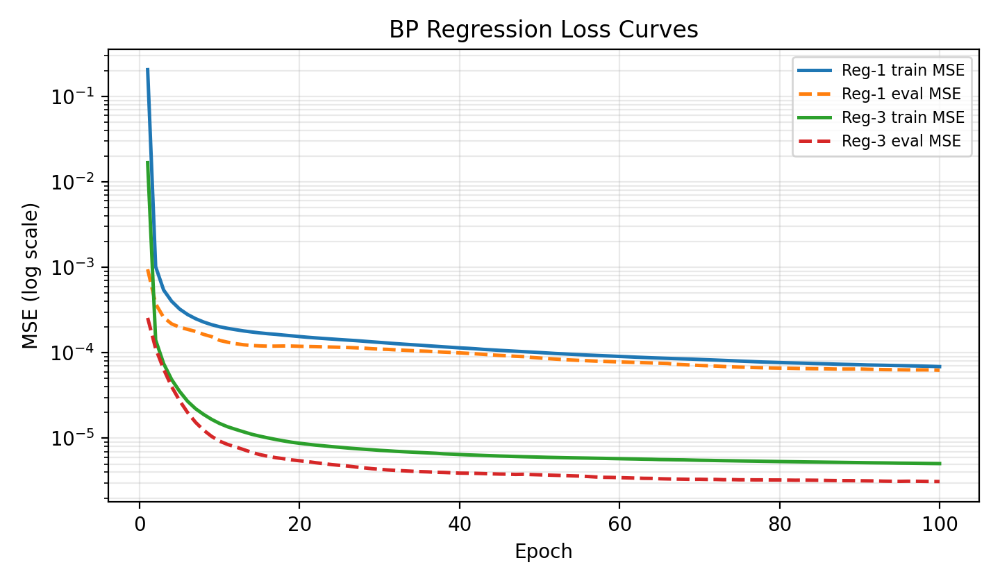
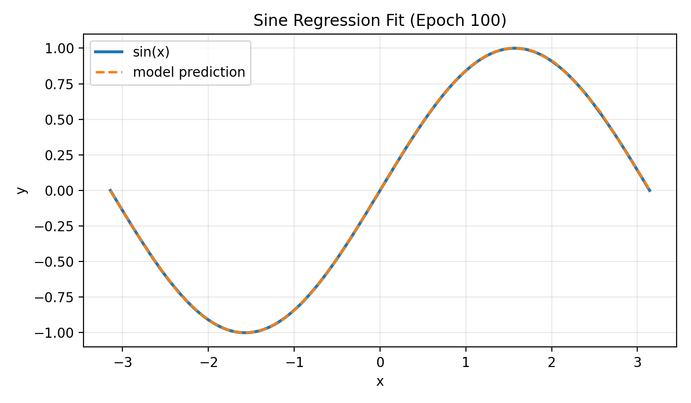
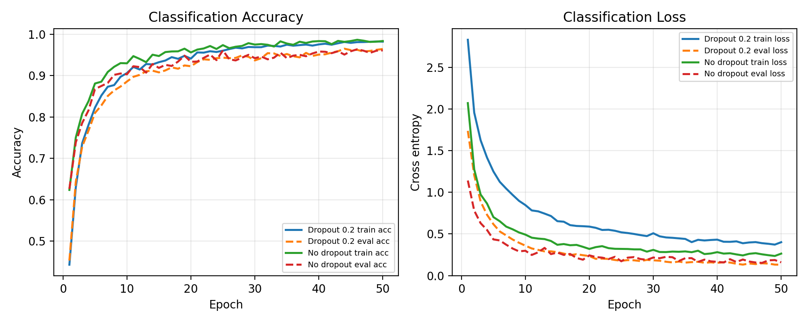
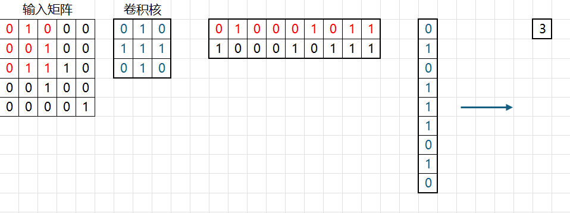

<!-- BEGIN doc/report/main.md -->

# Project 1 实验报告

姓名：尚书

学号：23307110117

日期：2026/4/17

## 目录

1. [项目概述](sections/01-overview.md)
2. [第一部分：反向传播算法](sections/02-backprop.md)
3. [第二部分：卷积神经网络](sections/03-cnn.md)
4. [总结](sections/04-conclusion.md)
<!-- END doc/report/main.md -->

<!-- BEGIN doc/report/sections/01-overview.md -->

# 项目概述

## 开发环境

| 项目 | 说明 |
| --- | --- |
| 操作系统 | Linux 6.6.87.2-microsoft-standard-WSL2 x86_64 GNU/Linux。 |
| 编译器 | `g++ 13.3.0`，使用 C++20 标准编译。 |
| 第三方库 | 使用 BLAS 进行矩阵乘法加速；使用 OpenMP 并行化部分循环；使用 `inih` 读取配置；使用 `stb_image` 读取 BMP 图像；使用 `doctest` 编写单元测试。<br/><br/>核心训练、反向传播和参数更新由项目代码自主实现。 |

## 仓库结构

项目中三个主要训练入口分别对应实验要求中的三个任务：`src/regression.cpp` 用于正弦函数回归，`src/classification.cpp` 用于基于全连接网络的手写汉字分类，`src/cnn.cpp` 用于卷积神经网络分类。

本项目没有直接依赖现成深度学习框架，而是围绕自定义的 `NDArray` 和 `Module` 两个抽象搭建训练流程。


`NDArray` 是项目中的基础张量类型，内部使用 `shared_ptr<vector<float>>` 管理实际存储，并用 C++20 的 `std::span<float>` 表示当前视图。这样做的好处是可以在不复制底层数据的情况下实现轻量级切片。例如 mini-batch 训练中调用 `slice(row_start, row_end)` 时，只会让新 `NDArray` 共享原始数据并指向对应的连续区间，从而减少频繁拷贝带来的开销。`NDArray` 同时维护 `shape`、`stride`、`ndim` 和 `numel`，支持索引访问、reshape、逐元素运算、广播、按轴求和/均值和二维矩阵乘法。

矩阵乘法是神经网络训练中的主要计算瓶颈，因此 `NDArray::matmul` 调用 BLAS 的 `cblas_sgemm` 完成二维矩阵乘法。全连接层、卷积层中的 `im2col` 变换后矩阵乘法都可以复用这一接口。逐元素激活函数、Dropout mask 和部分张量循环使用 OpenMP 并行化，以降低大 batch 或多通道特征图上的循环开销。

在代码组织方面，我们采用了接近 PyTorch 的模块化设计。所有网络层继承统一的 `Module` 接口，训练入口只需要按顺序调用各层的 `forward`、`backward`、`parameters` 和优化器更新逻辑即可。可训练参数通过 `Parameter` 结构暴露给优化器，在使用优化器时，由它接管负责 `step` 操作。

`Module` 是所有网络层的统一接口，主要包含以下方法：

| 方法 | 作用 |
| --- | --- |
| `forward` | 执行前向传播，并在需要时缓存输入或输出。 |
| `backward` | 接收上游梯度，计算本层参数梯度和传给前一层的梯度。 |
| `parameters` | 返回本层可训练参数及其梯度指针，供优化器统一管理。 |
| `train` / `eval` | 切换训练和推理行为，主要用于 Dropout、BatchNorm 等层。 |

在此基础上，MLP 由 `Linear + Activation + Dropout` 组合而成，CNN 由 `Conv2D + BatchNorm2D + Activation + MaxPool2D + Dropout` 组合而成。训练入口只负责数据读取、batch 划分、损失计算、反向传播和优化器更新，具体层的前向/反向细节则封装在各模块内部。

## 训练与复现流程

实验超参数通过 `ini/` 目录中的配置文件控制。`regression.ini` 配置正弦函数采样数量、隐藏层规模、学习率和训练轮数；`classification.ini` 配置 MLP 分类器的隐藏层、Dropout、Adam 参数、数据增强和 checkpoint；`cnn-bs64.ini` 配置 CNN 的卷积块数量、通道数、学习率调度器和数据增强强度。

训练流程整体如下：

1. 从配置文件读取数据路径、模型结构和优化器参数。
2. 构造数据集：回归任务随机采样 $x \in [-\pi, \pi]$；分类任务读取 28×28 BMP 图像并展平或 reshape 为 NCHW。
3. 构造模型和优化器，并在每个 epoch 内按 mini-batch 前向传播。
4. 计算损失函数，调用 `backward` 逐层反传梯度。
5. 调用优化器 `step` 更新所有参数，并通过 `zero_grad` 清空梯度。
6. 在验证集上计算指标，必要时保存验证指标最优的 checkpoint。

为了保证实现可靠性，项目使用 `doctest` 对关键模块进行单元测试，覆盖 `NDArray`、全连接层、Dropout、Conv2D、图像读取和 checkpoint 等功能。报告中的实验结果均基于这些自定义模块运行得到。

<!-- END doc/report/sections/01-overview.md -->

<!-- BEGIN doc/report/sections/02-backprop.md -->

# 第一部分：反向传播算法

## 任务内容

本部分基于反向传播算法自行设计并实现神经网络模型，完成回归和分类两个任务组。

## 算法原理

### 前向传播

设网络共有 $L$ 层可训练参数，输入样本向量记为 $a^0 = x$。第 $l$ 层首先对上一层输出做线性变换：

$$
z^l = W^l a^{l-1} + b^l,\quad l = 1, 2, \dots, L.
$$

其中 $W^l$ 为权重矩阵，$b^l$ 为偏置向量，$z^l$ 为该层的预激活输出。随后逐元素作用激活函数：

$$
a^l = \sigma^l(z^l).
$$

隐藏层激活函数 $\sigma^l$ 可以选用 ReLU、sigmoid 或 tanh 等非线性函数，从而赋予模型非线性表达能力。输出层根据任务选择不同形式：回归任务可令 $\hat{y} = a^L = z^L$，直接得到连续预测值；多分类任务可令 $\hat{y} = \operatorname{softmax}(z^L)$，得到各类别概率。整体前向传播就是不断重复“线性变换 + 激活函数”的组合，最终得到网络输出 $\hat{y}$。

### 损失函数与极大似然估计

损失函数的选择本质上与**极大似然估计**有关。极大似然估计本质上是认为：“如果一件事发生了，那么它就是最可能发生的”。它的目标是找到参数，使得已观测训练数据在模型下出现的概率最大。当模型输出被解释为某个条件概率分布的参数时，最小化负对数似然就等价于最大化数据似然。

对回归任务，设真实值由模型输出加独立同分布的高斯噪声产生：

$$
y = f_\theta(x) + \epsilon,\quad \epsilon \sim \mathcal{N}(0, \sigma^2).
$$

则条件概率为：

$$
p(y \mid x; \theta) =
\frac{1}{\sqrt{2\pi}\sigma}
\exp\left(-\frac{(y - f_\theta(x))^2}{2\sigma^2}\right).
$$

取负对数似然后得到：

$$
-\log p(y \mid x; \theta)
= \frac{(y - f_\theta(x))^2}{2\sigma^2} + C.
$$

其中 $C$ 与模型参数无关，因此最大化似然等价于最小化平方误差。实际训练时常使用均方误差：

$$
L_{\mathrm{MSE}} = \frac{1}{n}\sum_{i=1}^n (y_i - \hat{y}_i)^2.
$$

对多分类任务，模型最后一层通过 softmax 输出类别概率：

$$
\hat{y}_k = p(y = k \mid x; \theta)
= \frac{\exp(z_k)}{\sum_j \exp(z_j)}.
$$

若真实标签 $y$ 用 one-hot 向量表示，则单个样本的似然为真实类别对应的预测概率：

$$
p(y \mid x; \theta) = \prod_k \hat{y}_k^{y_k}.
$$

取负对数似然后得到交叉熵损失：

$$
L_{\mathrm{CE}} = -\sum_k y_k \log \hat{y}_k.
$$

因此，最小化交叉熵等价于最大化训练样本真实类别的条件概率。相比直接优化分类错误率，交叉熵是连续可导的，并且当模型对真实类别给出低概率时会产生更大的梯度信号，因此更适合梯度下降。

### 反向传播推导

反向传播的核心是对前向传播中的每一个中间变量应用链式法则。仍记第 $l$ 层的前向计算为：

$$
z^l = W^l a^{l-1} + b^l,\quad a^l = \sigma^l(z^l).
$$

定义误差项：

$$
\delta^l = \frac{\partial L}{\partial z^l},
$$

即损失函数对第 $l$ 层预激活输出的梯度。

首先考虑输出层。若输出层带有一般激活函数，则由链式法则可得：

$$
\delta^L =
\frac{\partial L}{\partial a^L}
\odot {\sigma^L}'(z^L),
$$

其中 $\odot$ 表示逐元素乘法。对回归任务，如果最后一层是线性输出并使用 MSE，则 ${\sigma^L}'(z^L)=1$，梯度直接由预测误差给出。对多分类任务，如果将 softmax 与交叉熵合并计算，则输出层梯度可化简为：

$$
\delta^L = \hat{y} - y.
$$

这个化简避免了显式计算 softmax 的完整雅可比矩阵，是分类网络中常用的实现方式。

对隐藏层，第 $l$ 层的损失梯度来自后一层。因为 $z^{l+1}=W^{l+1}a^l+b^{l+1}$，所以：

$$
\frac{\partial L}{\partial a^l}
= (W^{l+1})^T\delta^{l+1}.
$$

再乘上本层激活函数的导数，得到隐藏层误差项递推公式：

$$
\delta^l =
\left((W^{l+1})^T\delta^{l+1}\right)
\odot {\sigma^l}'(z^l),
\quad l = L-1, \dots, 1.
$$

得到 $\delta^l$ 后，第 $l$ 层参数梯度可由线性层公式推出：

$$
\frac{\partial L}{\partial W^l}
= \delta^l(a^{l-1})^T,\quad
\frac{\partial L}{\partial b^l}
= \delta^l.
$$

同时传给前一层的梯度为：

$$
\frac{\partial L}{\partial a^{l-1}}
= (W^l)^T\delta^l.
$$

在 mini-batch 训练中，若一批数据大小为 $m$，通常对每个样本的梯度求平均：

$$
\frac{\partial L}{\partial W^l}
= \frac{1}{m}\Delta^l(A^{l-1})^T,\quad
\frac{\partial L}{\partial b^l}
= \frac{1}{m}\sum_{i=1}^{m}\delta_i^l.
$$

其中 $A^{l-1}$ 和 $\Delta^l$ 分别表示该批样本在第 $l-1$ 层的输出矩阵和第 $l$ 层的误差项矩阵。优化器随后根据这些梯度更新 $W^l$ 和 $b^l$，完成一次训练迭代。

## 优化器：Adam
Adam 是分类任务中使用的自适应优化器。它可以看作 Momentum 和 RMSProp 的结合：一方面用一阶矩估计保存梯度的指数滑动平均，表示当前参数更新的主要方向；另一方面用二阶矩估计保存梯度平方的指数滑动平均，用于衡量每个参数维度上的梯度尺度。设第 $t$ 步梯度为 $g_t$，Adam 的更新为：

$$
m_t = \beta_1 m_{t-1} + (1-\beta_1)g_t,
\quad
v_t = \beta_2 v_{t-1} + (1-\beta_2)g_t^2.
$$

由于 $m_0$ 和 $v_0$ 初始化为 0，训练初期的矩估计会偏小，因此需要做 bias correction：

$$
\hat{m}_t = \frac{m_t}{1-\beta_1^t},
\quad
\hat{v}_t = \frac{v_t}{1-\beta_2^t}.
$$

最终参数更新公式为：

$$
\theta_t =
\theta_{t-1}
- \alpha \frac{\hat{m}_t}{\sqrt{\hat{v}_t}+\epsilon}.
$$

其中 $\alpha$ 是学习率，$\beta_1$ 和 $\beta_2$ 分别控制一阶矩、二阶矩的平滑程度，$\epsilon$ 用于避免除零。相比普通 SGD，Adam 会对不同参数使用不同的有效步长：历史梯度平方较大的参数更新会被抑制，梯度较小或较稀疏的参数仍能获得相对充分的更新。因此在手写汉字分类这类高维输入和多层网络中，Adam 通常比固定学习率 SGD 更容易快速收敛。

## 实验结果

以下结果为本地实际运行所得，均记录最后一个 epoch 的指标。回归任务指标为 MSE；分类任务使用训练集准确率、验证集交叉熵和验证集准确率评估。

| 实验 | 训练指标 | 验证 / 测试指标 | 备注 |
| --- | --- | --- | --- |
| 1-1 | train MSE = `6.89902e-05` | eval MSE = `6.25648e-05` | 2 个隐藏层，`hidden_size = 32`，ReLU，SGD，`lr = 0.01`，训练 100 epoch。 |
| 1-2 | train MSE = `0.000614239` | eval MSE = `0.000580451` | 2 个隐藏层，`hidden_size = 32`，Sigmoid，SGD，`lr = 0.01`，训练 100 epoch。|
| 1-3 | train MSE = `5.05598e-06` | eval MSE = `3.11855e-06` | 2 个隐藏层，`hidden_size = 64`，ReLU，SGD，`lr = 0.005`，训练 100 epoch。 |
| 2-1 | loss = `0.401189`，train acc = `0.9822` | eval loss = `0.131109`，eval acc = `0.9644` | 基线结构：3 个隐藏层，`hidden_size = 256`，ReLU，Dropout `0.2`，Adam，训练 50 epoch。 |
| 2-2 | loss = `0.264087`，train acc = `0.9837` | eval loss = `0.159386`，eval acc = `0.9610` | 去除 Dropout 对照：其余配置与 BP-Cls-1 相同，`dropout = 0.0`。训练损失更低，但验证损失更高，说明 Dropout 对泛化有一定帮助。 |

此外，我们也发现，如果回归任务使用 3 个隐藏层、`hidden_size = 64` 且仍保持 `lr = 0.01`，训练中很容易出现 NaN。这是因为更深、更宽的 ReLU 网络会放大参数更新的尺度，SGD 又没有 Adam 那样的自适应步长控制；当某一轮更新过大时，后续线性层输出和平方误差梯度都会被继续放大，最终可能产生数值溢出。将学习率降到 `0.005` 后，同样加宽的网络可以稳定训练，并取得更低的验证 MSE。



图 1 展示了 1-1 和 1-3 的回归 loss 曲线。1-3 的隐藏单元数更多，并配合更小学习率，训练和验证 MSE 都明显低于基线。



图 2 展示了第 100 个 epoch 的正弦函数拟合效果。模型预测曲线与真实的 $\sin(x)$ 曲线基本重合，说明 MLP 已经学到目标函数的主要形状。



图 3 对比了分类任务中保留 Dropout 和去除 Dropout 的训练过程。去除 Dropout 后训练 loss 更低，但验证 loss 略高，说明模型更容易贴合训练集；保留 Dropout 虽然训练损失较高，但最终验证表现更稳定。

## 分析与讨论

MLP 在正弦函数回归中本质上学习的是一维连续函数映射。由于正弦函数平滑且输入维度低，使用少量隐藏层和 ReLU 非线性即可近似目标函数；隐藏层规模过小会导致欠拟合，隐藏层过深或学习率过大则可能使训练不稳定。回归任务的关键观察应包括训练误差是否持续下降、验证误差是否达到 0.01 以下，以及预测曲线在区间边界处是否出现明显偏差。

在手写汉字分类任务中，MLP 将 $28\times28$ 图像展平为 784 维向量后输入网络。这种做法实现简单，但会破坏图像的二维空间结构：相邻像素之间的局部关系、笔画方向和部件位置不会被显式建模。因此，全连接网络需要通过更多参数自行学习这些局部模式，数据量不足时更容易过拟合。Dropout 和数据增强可以缓解过拟合，Adam 则有助于在不同参数维度上自适应调整步长，提高分类任务的收敛速度。

<!-- END doc/report/sections/02-backprop.md -->

<!-- BEGIN doc/report/sections/03-cnn.md -->

# 第二部分：卷积神经网络

## 任务内容

使用卷积神经网络完成 12 个手写汉字分类任务。该部分允许使用 PyTorch 等深度学习框架，但本项目仍采用 C++ 自主实现 CNN 的主要模块，包括卷积、池化、BatchNorm、Dropout、全连接层、反向传播和参数更新。

## CNN 结构与模块实现

### 卷积层

卷积层输入采用 NCHW 格式，形状为 $N \times C_{\mathrm{in}} \times H \times W$。若卷积核大小为 $K$，步幅为 $S$，填充为 $P$，输出通道数为 $C_{\mathrm{out}}$，则输出空间尺寸为：

$$
H_{\mathrm{out}} =
\left\lfloor\frac{H + 2P - K}{S}\right\rfloor + 1,\quad
W_{\mathrm{out}} =
\left\lfloor\frac{W + 2P - K}{S}\right\rfloor + 1.
$$

输出张量形状为 $N \times C_{\mathrm{out}} \times H_{\mathrm{out}} \times W_{\mathrm{out}}$。卷积层参数量为：

$$
C_{\mathrm{out}} \times C_{\mathrm{in}} \times K \times K + C_{\mathrm{out}},
$$

其中前一项是卷积核权重，后一项是每个输出通道对应的偏置。

项目中的 `Conv2D` 使用 `im2col` 将卷积转换为矩阵乘法。这能够大大提高计算效率。实际上，朴素实现的多层循环 CNN，在我的框架下，几乎是无法训练起来的。

#### im2col 的具体实现

我们知道，原始 CNN 的核心公式是：

$$
o[n, oc, oh, ow] = \sum_{ic, kh, kw} x[n, ic, ih, iw] \times W[oc, ic, kh, kw] + b[oc]
$$

这个算法是十分低效的。因为需要不断地在内存中跳跃才能完成计算。因此，我们引入 im2col 和 col2im 机制。这个机制的本质是等式的变换：我们将卷积核和输入**分别摊平为一行和一列**，然后进行点乘（也就是矩阵乘法）运算。

这里其实需要假定的是： **矩阵乘法是比手写循环更快的**。实际上，GPU 上的 cuBLAS 和 CPU 上的 OpenBLAS 都是高度优化的程序库。以 CPU 为例，它可以使用 AVX512 等原生的指令集优化。

在具体执行摊平时，我们需要：

首先使用 `weights_to_2d` 函数进行卷积核张量的预处理。我们本来的形态是 `[out_channels, in_channels, kernel_size, kernel_size]`，在预处理后，变为 `[in_channels * kernel_size * kernel_size, out_channels]`。

接着，使用 `im2col` 进行输入矩阵的预处理。我们将卷积核可能会看到的局部窗口全部提取出来，并且将每个窗口展开为一个一维向量，作为矩阵的一行。

具体参考如图：


反向传播时，`grad_out` 先被 reshape 成二维矩阵。偏置梯度是 `grad_out` 在 batch 和空间位置上的求和；权重梯度由 `col_cache^T @ grad2d` 得到；输入梯度先计算 `grad2d @ W^T`，再通过 `col2im` 把展开后的梯度累加回原始输入图像位置。由于一个输入像素可能参与多个卷积窗口，`col2im` 中需要把来自不同窗口的梯度相加。

### 池化层

池化层用于降低空间分辨率并扩大后续特征的感受野。

我们实现了 `MaxPool2D`，配置中采用 $2 \times 2$ 窗口和步幅 2。对于输入 $N \times C \times H \times W$，输出空间尺寸为：

$$
H_{\mathrm{out}} = \left\lfloor\frac{H-K}{S}\right\rfloor + 1,\quad
W_{\mathrm{out}} = \left\lfloor\frac{W-K}{S}\right\rfloor + 1.
$$

最大池化在每个窗口内保留最大激活值，因此能够减少特征图尺寸、降低后续计算量，并使模型对小范围平移具有一定鲁棒性。反向传播时，只有前向传播中取得最大值的位置接收上游梯度，其余位置梯度为 0。代码中通过 `max_h_cache` 和 `max_w_cache` 缓存最大值所在坐标，反向阶段再把每个池化输出位置的梯度 scatter 回对应输入位置。

### 归一化与正则化

BatchNorm2D 对每个通道分别统计均值和方差，统计范围覆盖 batch 维和空间维，即每个通道使用 $N \times H \times W$ 个值计算均值与方差。训练阶段使用当前 mini-batch 的统计量，并以 momentum 更新 `running_mean` 和 `running_var`；推理阶段使用滑动平均统计量，以保证输出稳定。归一化后再通过可学习参数 $\gamma$ 和 $\beta$ 做仿射变换：

$$
\operatorname{BN}(x) = \gamma \frac{x-\mu}{\sqrt{\sigma^2+\epsilon}} + \beta.
$$

BatchNorm 的作用是缓解中间特征分布随参数更新而剧烈变化的问题，使较深的 CNN 更容易训练，并允许使用相对稳定的学习率。

> [!note]
> **为什么需要做一次仿射变换，而不是直接取 `running_mean` 和 `running_var` 呢？**
> 
> 假设没有仿射变换，BatchNorm2D 的输出就是：
> ```
> output = (input - running_mean) / sqrt(running_var + eps)
> ```
> 
> 这确实能稳定训练、加速收敛、允许使用更大的学习率。但它有一个致命的副作用：强制每一层的输出分布都变成标准正态分布（均值 0，方差 1）。
> 
> **这为什么不好？** 我的理解是，主要是因为这种做法限制了网络的表达能力：想象一下，网络的前一层可能已经学习到了一个对当前任务非常有用的特征分布，比如某个通道的特征值普遍偏大（均值 > 0），或者特征之间的差异需要特定的尺度（方差 ≠ 1）。强制归一化会把这些有用的信息“洗掉”。

Dropout 在训练阶段随机将部分激活置零，并使用 inverted dropout，将保留下来的激活除以保留概率，使训练和推理阶段的期望一致。推理阶段 Dropout 直接返回输入，不再随机屏蔽。CNN 配置中在每个卷积块的池化后使用 Dropout，MLP 分类器中也在隐藏层后使用 Dropout，以减少特征之间的共适应。

数据增强用于从输入层面提升泛化能力。当前配置包括随机平移、随机旋转、形态学扰动和高斯噪声：平移和旋转模拟书写位置与角度变化，形态学扰动模拟笔画粗细变化，高斯噪声提升模型对图像噪声的鲁棒性。

## 网络设计

| 阶段 | 层 / 操作 | 输出形状 | 说明 |
| --- | --- | --- | --- |
| Input | 输入图像 | `1×28×28` | 手写汉字灰度图，训练入口中先由 `[N, 784]` reshape 为 NCHW。 |
| Block 1 | Conv + BN + ReLU + Conv + BN + ReLU + MaxPool + Dropout | `32×14×14` | 提取低级笔画特征。 |
| Block 2 | Conv + BN + ReLU + Conv + BN + ReLU + MaxPool + Dropout | `64×7×7` | 提取局部结构特征。 |
| Block 3 | Conv + BN + ReLU + Conv + BN + ReLU + MaxPool + Dropout | `128×3×3` | 进一步扩大通道数并压缩空间分辨率。 |
| Classifier | Flatten + Linear + ReLU + Linear | `12` | 展平特征后经过隐藏全连接层，最终输出 12 类 logits。 |

## 结果分析

CNN 相比 MLP 更适合图像分类，原因在于卷积层利用局部连接和权值共享捕捉局部笔画模式。同一个卷积核会在整张图上滑动，因此模型能够在不同空间位置识别相似的笔画结构；池化进一步降低了对小范围平移的敏感性。对于手写汉字分类，这些性质比直接展平像素更符合数据结构。

实验分析，我通过观察训练集和验证集曲线之间的差距，发现了两种不同的症状：
- 如果训练准确率持续升高而验证准确率停滞或下降，说明模型开始过拟合，此时数据增强、Dropout、BatchNorm 和 checkpoint 选择会更重要。
- 如果训练准确率和验证准确率都较低，则可能是模型容量不足、训练轮数不足、学习率不合适或预处理方式不匹配。

最终提交模型应优先选择验证集指标最优的 checkpoint，而不是最后一个 epoch 的参数。我们在训练阶段就按 `eval_loss` 保存最佳 checkpoint，并在推理阶段从 checkpoint 加载参数，因此可以降低训练后期波动对最终结果的影响。
<!-- END doc/report/sections/03-cnn.md -->

<!-- BEGIN doc/report/sections/04-conclusion.md -->

# 总结

## 主要结果
任务 1：

回归任务：MAE 满足 <0.01> 要求

分类任务：
```shell
$ build/classification --inference checkpoints/best_classification.ckpt 
Loaded checkpoint checkpoints/best_classification.ckpt (epoch 50, eval_loss = 0.127526)
Loading inference dataset from data/test...
Inference loss: 0.127526, accuracy: 0.9637
```

任务 2：
```shell
$ build/cnn --inference checkpoints/best_cnn_bs64.ckpt
Loaded checkpoint checkpoints/best_cnn_bs64.ckpt (epoch 11, eval_loss = 0.016389)
Loading inference dataset from data/test...
Inference loss: 0.016389, accuracy: 0.9966
```

## 经验与不足

本项目实现了从基础 MLP 到 CNN 的完整训练流程。BP 部分展示了全连接网络如何通过前向传播、损失函数和链式法则完成参数学习；CNN 部分进一步利用局部连接、权值共享和池化结构，更好地匹配图像数据的空间特征。

从表达能力看，MLP 可以拟合一般函数，也可以处理展平后的图像输入，但它没有显式利用二维邻域结构；CNN 则通过卷积核提取局部笔画和部件特征，同一组参数可以在不同位置复用，因此在图像分类任务上通常具有更好的参数效率和泛化能力。

从收敛角度看，Adam、BatchNorm 和学习率调度器可以提升训练稳定性；从泛化角度看，数据增强、Dropout 和最佳 checkpoint 保存可以缓解过拟合。

同时，我也深刻认识到了如何正确地利用好计算资源。通过实现看似神秘的 im2col 机制，我了解了如何使用通用矩阵乘法（GEMM）来处理看似和矩阵乘法无关的运算需求。这帮助了我理解未来进行真实世界的底层算子开发所需要的知识。
<!-- END doc/report/sections/04-conclusion.md -->
