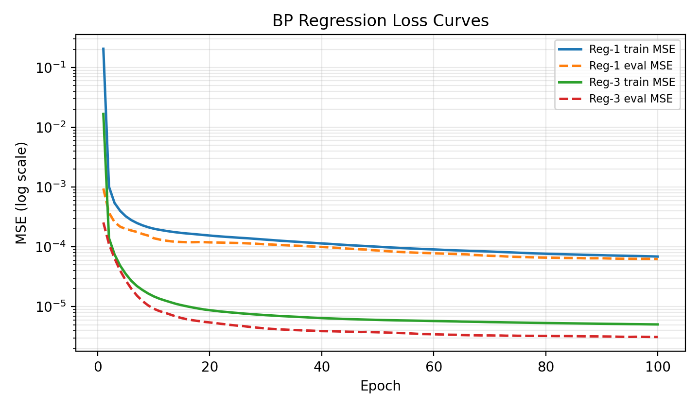
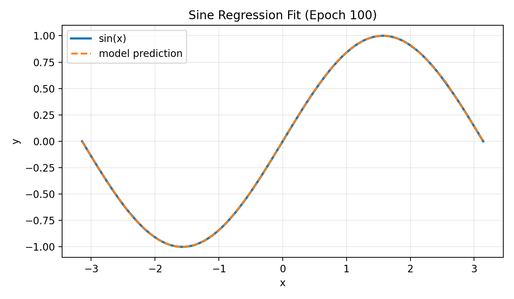
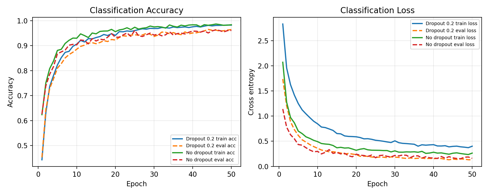

# 第一部分：反向传播算法

## 任务内容

本部分基于反向传播算法自行设计并实现神经网络模型，完成回归和分类两个任务组。

## 算法原理

### 前向传播

设网络共有 $L$ 层可训练参数，输入样本向量记为 $a^0 = x$。第 $l$ 层首先对上一层输出做线性变换：

$$
z^l = W^l a^{l-1} + b^l,\quad l = 1, 2, \dots, L.
$$

其中 $W^l$ 为权重矩阵，$b^l$ 为偏置向量，$z^l$ 为该层的预激活输出。随后逐元素作用激活函数：

$$
a^l = \sigma^l(z^l).
$$

隐藏层激活函数 $\sigma^l$ 可以选用 ReLU、sigmoid 或 tanh 等非线性函数，从而赋予模型非线性表达能力。输出层根据任务选择不同形式：回归任务可令 $\hat{y} = a^L = z^L$，直接得到连续预测值；多分类任务可令 $\hat{y} = \operatorname{softmax}(z^L)$，得到各类别概率。整体前向传播就是不断重复“线性变换 + 激活函数”的组合，最终得到网络输出 $\hat{y}$。

### 损失函数与极大似然估计

损失函数的选择本质上与**极大似然估计**有关。极大似然估计本质上是认为：“如果一件事发生了，那么它就是最可能发生的”。它的目标是找到参数，使得已观测训练数据在模型下出现的概率最大。当模型输出被解释为某个条件概率分布的参数时，最小化负对数似然就等价于最大化数据似然。

对回归任务，设真实值由模型输出加独立同分布的高斯噪声产生：

$$
y = f_\theta(x) + \epsilon,\quad \epsilon \sim \mathcal{N}(0, \sigma^2).
$$

则条件概率为：

$$
p(y \mid x; \theta) =
\frac{1}{\sqrt{2\pi}\sigma}
\exp\left(-\frac{(y - f_\theta(x))^2}{2\sigma^2}\right).
$$

取负对数似然后得到：

$$
-\log p(y \mid x; \theta)
= \frac{(y - f_\theta(x))^2}{2\sigma^2} + C.
$$

其中 $C$ 与模型参数无关，因此最大化似然等价于最小化平方误差。实际训练时常使用均方误差：

$$
L_{\mathrm{MSE}} = \frac{1}{n}\sum_{i=1}^n (y_i - \hat{y}_i)^2.
$$

对多分类任务，模型最后一层通过 softmax 输出类别概率：

$$
\hat{y}_k = p(y = k \mid x; \theta)
= \frac{\exp(z_k)}{\sum_j \exp(z_j)}.
$$

若真实标签 $y$ 用 one-hot 向量表示，则单个样本的似然为真实类别对应的预测概率：

$$
p(y \mid x; \theta) = \prod_k \hat{y}_k^{y_k}.
$$

取负对数似然后得到交叉熵损失：

$$
L_{\mathrm{CE}} = -\sum_k y_k \log \hat{y}_k.
$$

因此，最小化交叉熵等价于最大化训练样本真实类别的条件概率。相比直接优化分类错误率，交叉熵是连续可导的，并且当模型对真实类别给出低概率时会产生更大的梯度信号，因此更适合梯度下降。

### 反向传播推导

反向传播的核心是对前向传播中的每一个中间变量应用链式法则。仍记第 $l$ 层的前向计算为：

$$
z^l = W^l a^{l-1} + b^l,\quad a^l = \sigma^l(z^l).
$$

定义误差项：

$$
\delta^l = \frac{\partial L}{\partial z^l},
$$

即损失函数对第 $l$ 层预激活输出的梯度。

首先考虑输出层。若输出层带有一般激活函数，则由链式法则可得：

$$
\delta^L =
\frac{\partial L}{\partial a^L}
\odot {\sigma^L}'(z^L),
$$

其中 $\odot$ 表示逐元素乘法。对回归任务，如果最后一层是线性输出并使用 MSE，则 ${\sigma^L}'(z^L)=1$，梯度直接由预测误差给出。对多分类任务，如果将 softmax 与交叉熵合并计算，则输出层梯度可化简为：

$$
\delta^L = \hat{y} - y.
$$

这个化简避免了显式计算 softmax 的完整雅可比矩阵，是分类网络中常用的实现方式。

对隐藏层，第 $l$ 层的损失梯度来自后一层。因为 $z^{l+1}=W^{l+1}a^l+b^{l+1}$，所以：

$$
\frac{\partial L}{\partial a^l}
= (W^{l+1})^T\delta^{l+1}.
$$

再乘上本层激活函数的导数，得到隐藏层误差项递推公式：

$$
\delta^l =
\left((W^{l+1})^T\delta^{l+1}\right)
\odot {\sigma^l}'(z^l),
\quad l = L-1, \dots, 1.
$$

得到 $\delta^l$ 后，第 $l$ 层参数梯度可由线性层公式推出：

$$
\frac{\partial L}{\partial W^l}
= \delta^l(a^{l-1})^T,\quad
\frac{\partial L}{\partial b^l}
= \delta^l.
$$

同时传给前一层的梯度为：

$$
\frac{\partial L}{\partial a^{l-1}}
= (W^l)^T\delta^l.
$$

在 mini-batch 训练中，若一批数据大小为 $m$，通常对每个样本的梯度求平均：

$$
\frac{\partial L}{\partial W^l}
= \frac{1}{m}\Delta^l(A^{l-1})^T,\quad
\frac{\partial L}{\partial b^l}
= \frac{1}{m}\sum_{i=1}^{m}\delta_i^l.
$$

其中 $A^{l-1}$ 和 $\Delta^l$ 分别表示该批样本在第 $l-1$ 层的输出矩阵和第 $l$ 层的误差项矩阵。优化器随后根据这些梯度更新 $W^l$ 和 $b^l$，完成一次训练迭代。

## 优化器：Adam
Adam 是分类任务中使用的自适应优化器。它可以看作 Momentum 和 RMSProp 的结合：一方面用一阶矩估计保存梯度的指数滑动平均，表示当前参数更新的主要方向；另一方面用二阶矩估计保存梯度平方的指数滑动平均，用于衡量每个参数维度上的梯度尺度。设第 $t$ 步梯度为 $g_t$，Adam 的更新为：

$$
m_t = \beta_1 m_{t-1} + (1-\beta_1)g_t,
\quad
v_t = \beta_2 v_{t-1} + (1-\beta_2)g_t^2.
$$

由于 $m_0$ 和 $v_0$ 初始化为 0，训练初期的矩估计会偏小，因此需要做 bias correction：

$$
\hat{m}_t = \frac{m_t}{1-\beta_1^t},
\quad
\hat{v}_t = \frac{v_t}{1-\beta_2^t}.
$$

最终参数更新公式为：

$$
\theta_t =
\theta_{t-1}
- \alpha \frac{\hat{m}_t}{\sqrt{\hat{v}_t}+\epsilon}.
$$

其中 $\alpha$ 是学习率，$\beta_1$ 和 $\beta_2$ 分别控制一阶矩、二阶矩的平滑程度，$\epsilon$ 用于避免除零。相比普通 SGD，Adam 会对不同参数使用不同的有效步长：历史梯度平方较大的参数更新会被抑制，梯度较小或较稀疏的参数仍能获得相对充分的更新。因此在手写汉字分类这类高维输入和多层网络中，Adam 通常比固定学习率 SGD 更容易快速收敛。

## 实验结果

以下结果为本地实际运行所得，均记录最后一个 epoch 的指标。回归任务指标为 MSE；分类任务使用训练集准确率、验证集交叉熵和验证集准确率评估。

| 实验 | 训练指标 | 验证 / 测试指标 | 备注 |
| --- | --- | --- | --- |
| 1-1 | train MSE = `6.89902e-05` | eval MSE = `6.25648e-05` | 2 个隐藏层，`hidden_size = 32`，ReLU，SGD，`lr = 0.01`，训练 100 epoch。 |
| 1-2 | train MSE = `0.000614239` | eval MSE = `0.000580451` | 2 个隐藏层，`hidden_size = 32`，Sigmoid，SGD，`lr = 0.01`，训练 100 epoch。|
| 1-3 | train MSE = `5.05598e-06` | eval MSE = `3.11855e-06` | 2 个隐藏层，`hidden_size = 64`，ReLU，SGD，`lr = 0.005`，训练 100 epoch。 |
| 2-1 | loss = `0.401189`，train acc = `0.9822` | eval loss = `0.131109`，eval acc = `0.9644` | 基线结构：3 个隐藏层，`hidden_size = 256`，ReLU，Dropout `0.2`，Adam，训练 50 epoch。 |
| 2-2 | loss = `0.264087`，train acc = `0.9837` | eval loss = `0.159386`，eval acc = `0.9610` | 去除 Dropout 对照：其余配置与 BP-Cls-1 相同，`dropout = 0.0`。训练损失更低，但验证损失更高，说明 Dropout 对泛化有一定帮助。 |

此外，我们也发现，如果回归任务使用 3 个隐藏层、`hidden_size = 64` 且仍保持 `lr = 0.01`，训练中很容易出现 NaN。这是因为更深、更宽的 ReLU 网络会放大参数更新的尺度，SGD 又没有 Adam 那样的自适应步长控制；当某一轮更新过大时，后续线性层输出和平方误差梯度都会被继续放大，最终可能产生数值溢出。将学习率降到 `0.005` 后，同样加宽的网络可以稳定训练，并取得更低的验证 MSE。

图 1 展示了 1-1 和 1-3 的回归 loss 曲线。1-3 的隐藏单元数更多，并配合更小学习率，训练和验证 MSE 都明显低于基线。

图 2 展示了第 100 个 epoch 的正弦函数拟合效果。模型预测曲线与真实的 $\sin(x)$ 曲线基本重合，说明 MLP 已经学到目标函数的主要形状。

图 3 对比了分类任务中保留 Dropout 和去除 Dropout 的训练过程。去除 Dropout 后训练 loss 更低，但验证 loss 略高，说明模型更容易贴合训练集；保留 Dropout 虽然训练损失较高，但最终验证表现更稳定。

## 分析与讨论

MLP 在正弦函数回归中本质上学习的是一维连续函数映射。由于正弦函数平滑且输入维度低，使用少量隐藏层和 ReLU 非线性即可近似目标函数；隐藏层规模过小会导致欠拟合，隐藏层过深或学习率过大则可能使训练不稳定。回归任务的关键观察应包括训练误差是否持续下降、验证误差是否达到 0.01 以下，以及预测曲线在区间边界处是否出现明显偏差。

在手写汉字分类任务中，MLP 将 $28\times28$ 图像展平为 784 维向量后输入网络。这种做法实现简单，但会破坏图像的二维空间结构：相邻像素之间的局部关系、笔画方向和部件位置不会被显式建模。因此，全连接网络需要通过更多参数自行学习这些局部模式，数据量不足时更容易过拟合。Dropout 和数据增强可以缓解过拟合，Adam 则有助于在不同参数维度上自适应调整步长，提高分类任务的收敛速度。
