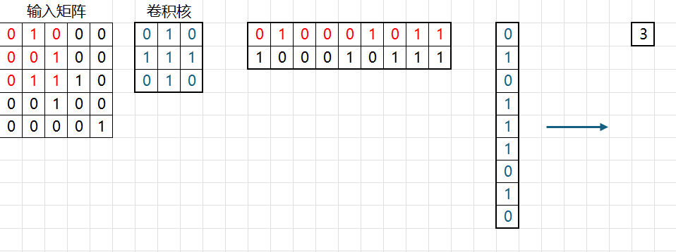

# 第二部分：卷积神经网络

## 任务内容

使用卷积神经网络完成 12 个手写汉字分类任务。该部分允许使用 PyTorch 等深度学习框架，但本项目仍采用 C++ 自主实现 CNN 的主要模块，包括卷积、池化、BatchNorm、Dropout、全连接层、反向传播和参数更新。

## CNN 结构与模块实现

### 卷积层

卷积层输入采用 NCHW 格式，形状为 $N \times C_{\mathrm{in}} \times H \times W$。若卷积核大小为 $K$，步幅为 $S$，填充为 $P$，输出通道数为 $C_{\mathrm{out}}$，则输出空间尺寸为：

$$
H_{\mathrm{out}} =
\left\lfloor\frac{H + 2P - K}{S}\right\rfloor + 1,\quad
W_{\mathrm{out}} =
\left\lfloor\frac{W + 2P - K}{S}\right\rfloor + 1.
$$

输出张量形状为 $N \times C_{\mathrm{out}} \times H_{\mathrm{out}} \times W_{\mathrm{out}}$。卷积层参数量为：

$$
C_{\mathrm{out}} \times C_{\mathrm{in}} \times K \times K + C_{\mathrm{out}},
$$

其中前一项是卷积核权重，后一项是每个输出通道对应的偏置。

项目中的 `Conv2D` 使用 `im2col` 将卷积转换为矩阵乘法。这能够大大提高计算效率。实际上，朴素实现的多层循环 CNN，在我的框架下，几乎是无法训练起来的。

#### im2col 的具体实现

我们知道，原始 CNN 的核心公式是：

$$
o[n, oc, oh, ow] = \sum_{ic, kh, kw} x[n, ic, ih, iw] \times W[oc, ic, kh, kw] + b[oc]
$$

这个算法是十分低效的。因为需要不断地在内存中跳跃才能完成计算。因此，我们引入 im2col 和 col2im 机制。这个机制的本质是等式的变换：我们将卷积核和输入**分别摊平为一行和一列**，然后进行点乘（也就是矩阵乘法）运算。

这里其实需要假定的是： **矩阵乘法是比手写循环更快的**。实际上，GPU 上的 cuBLAS 和 CPU 上的 OpenBLAS 都是高度优化的程序库。以 CPU 为例，它可以使用 AVX512 等原生的指令集优化。

在具体执行摊平时，我们需要：

首先使用 `weights_to_2d` 函数进行卷积核张量的预处理。我们本来的形态是 `[out_channels, in_channels, kernel_size, kernel_size]`，在预处理后，变为 `[in_channels * kernel_size * kernel_size, out_channels]`。

接着，使用 `im2col` 进行输入矩阵的预处理。我们将卷积核可能会看到的局部窗口全部提取出来，并且将每个窗口展开为一个一维向量，作为矩阵的一行。

具体参考如图：


反向传播时，`grad_out` 先被 reshape 成二维矩阵。偏置梯度是 `grad_out` 在 batch 和空间位置上的求和；权重梯度由 `col_cache^T @ grad2d` 得到；输入梯度先计算 `grad2d @ W^T`，再通过 `col2im` 把展开后的梯度累加回原始输入图像位置。由于一个输入像素可能参与多个卷积窗口，`col2im` 中需要把来自不同窗口的梯度相加。

### 池化层

池化层用于降低空间分辨率并扩大后续特征的感受野。

我们实现了 `MaxPool2D`，配置中采用 $2 \times 2$ 窗口和步幅 2。对于输入 $N \times C \times H \times W$，输出空间尺寸为：

$$
H_{\mathrm{out}} = \left\lfloor\frac{H-K}{S}\right\rfloor + 1,\quad
W_{\mathrm{out}} = \left\lfloor\frac{W-K}{S}\right\rfloor + 1.
$$

最大池化在每个窗口内保留最大激活值，因此能够减少特征图尺寸、降低后续计算量，并使模型对小范围平移具有一定鲁棒性。反向传播时，只有前向传播中取得最大值的位置接收上游梯度，其余位置梯度为 0。代码中通过 `max_h_cache` 和 `max_w_cache` 缓存最大值所在坐标，反向阶段再把每个池化输出位置的梯度 scatter 回对应输入位置。

### 归一化与正则化

BatchNorm2D 对每个通道分别统计均值和方差，统计范围覆盖 batch 维和空间维，即每个通道使用 $N \times H \times W$ 个值计算均值与方差。训练阶段使用当前 mini-batch 的统计量，并以 momentum 更新 `running_mean` 和 `running_var`；推理阶段使用滑动平均统计量，以保证输出稳定。归一化后再通过可学习参数 $\gamma$ 和 $\beta$ 做仿射变换：

$$
\operatorname{BN}(x) = \gamma \frac{x-\mu}{\sqrt{\sigma^2+\epsilon}} + \beta.
$$

BatchNorm 的作用是缓解中间特征分布随参数更新而剧烈变化的问题，使较深的 CNN 更容易训练，并允许使用相对稳定的学习率。

> [!note]
> **为什么需要做一次仿射变换，而不是直接取 `running_mean` 和 `running_var` 呢？**
> 
> 假设没有仿射变换，BatchNorm2D 的输出就是：
> ```
> output = (input - running_mean) / sqrt(running_var + eps)
> ```
> 
> 这确实能稳定训练、加速收敛、允许使用更大的学习率。但它有一个致命的副作用：强制每一层的输出分布都变成标准正态分布（均值 0，方差 1）。
> 
> **这为什么不好？** 我的理解是，主要是因为这种做法限制了网络的表达能力：想象一下，网络的前一层可能已经学习到了一个对当前任务非常有用的特征分布，比如某个通道的特征值普遍偏大（均值 > 0），或者特征之间的差异需要特定的尺度（方差 ≠ 1）。强制归一化会把这些有用的信息“洗掉”。

Dropout 在训练阶段随机将部分激活置零，并使用 inverted dropout，将保留下来的激活除以保留概率，使训练和推理阶段的期望一致。推理阶段 Dropout 直接返回输入，不再随机屏蔽。CNN 配置中在每个卷积块的池化后使用 Dropout，MLP 分类器中也在隐藏层后使用 Dropout，以减少特征之间的共适应。

数据增强用于从输入层面提升泛化能力。当前配置包括随机平移、随机旋转、形态学扰动和高斯噪声：平移和旋转模拟书写位置与角度变化，形态学扰动模拟笔画粗细变化，高斯噪声提升模型对图像噪声的鲁棒性。

## 网络设计

| 阶段 | 层 / 操作 | 输出形状 | 说明 |
| --- | --- | --- | --- |
| Input | 输入图像 | `1×28×28` | 手写汉字灰度图，训练入口中先由 `[N, 784]` reshape 为 NCHW。 |
| Block 1 | Conv + BN + ReLU + Conv + BN + ReLU + MaxPool + Dropout | `32×14×14` | 提取低级笔画特征。 |
| Block 2 | Conv + BN + ReLU + Conv + BN + ReLU + MaxPool + Dropout | `64×7×7` | 提取局部结构特征。 |
| Block 3 | Conv + BN + ReLU + Conv + BN + ReLU + MaxPool + Dropout | `128×3×3` | 进一步扩大通道数并压缩空间分辨率。 |
| Classifier | Flatten + Linear + ReLU + Linear | `12` | 展平特征后经过隐藏全连接层，最终输出 12 类 logits。 |

## 结果分析

CNN 相比 MLP 更适合图像分类，原因在于卷积层利用局部连接和权值共享捕捉局部笔画模式。同一个卷积核会在整张图上滑动，因此模型能够在不同空间位置识别相似的笔画结构；池化进一步降低了对小范围平移的敏感性。对于手写汉字分类，这些性质比直接展平像素更符合数据结构。

实验分析，我通过观察训练集和验证集曲线之间的差距，发现了两种不同的症状：
- 如果训练准确率持续升高而验证准确率停滞或下降，说明模型开始过拟合，此时数据增强、Dropout、BatchNorm 和 checkpoint 选择会更重要。
- 如果训练准确率和验证准确率都较低，则可能是模型容量不足、训练轮数不足、学习率不合适或预处理方式不匹配。

最终提交模型应优先选择验证集指标最优的 checkpoint，而不是最后一个 epoch 的参数。我们在训练阶段就按 `eval_loss` 保存最佳 checkpoint，并在推理阶段从 checkpoint 加载参数，因此可以降低训练后期波动对最终结果的影响。